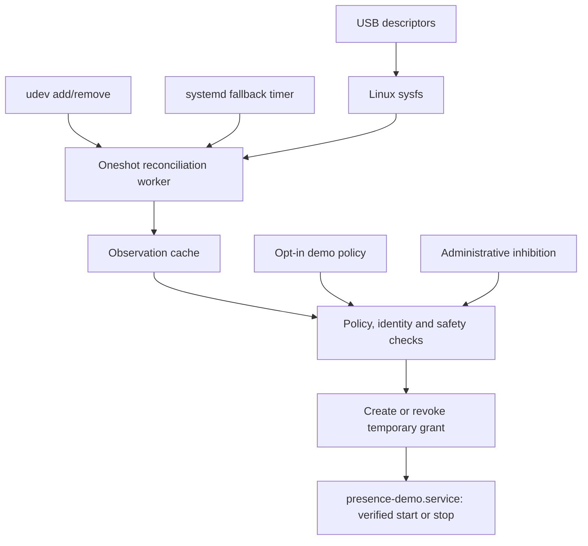

# USB Presence Gate

[](https://github.com/kayo-willian/usb-presence-gate/actions/workflows/test.yml)


[](LICENSE)


A lightweight USB presence observer and opt-in service gate for headless Linux, built with Python's standard library, sysfs, udev and systemd. I built this project to explore how physical USB events, service availability and safe recovery interact on a resource-limited Debian notebook.

The experimental demonstration was completed and tested on November 22, 2026. Subsequent reviews have strengthened failure handling, administrative synchronization and systemd/udev verification. Development remains experimental; further hardening and live validation are pending.

> **Not an authentication system or a production security product.** The gate controls only the bundled disposable `presence-demo.service`. USB descriptors can be spoofed. Never use this project to protect SSH, networking, authentication, firewalls, Docker or other essential services.

[Português (Brasil)](pt-BR/README.md) · [Installation](#installation) · [Usage](#usage) · [Recovery](#emergency-recovery-without-python) · [Contributing](#contributing) · [Changelog](CHANGELOG.md)

## Contents

- [How it works](#how-it-works)
- [Requirements](#requirements)
- [Installation](#installation)
- [Usage](#usage)
- [Commands and diagnostics](#commands-and-diagnostics)
- [Shutdown, uninstall and updates](#shutdown-uninstall-and-updates)
- [Emergency recovery without Python](#emergency-recovery-without-python)
- [Limitations and extension](#limitations-and-extension)
- [Project status and validation](#project-status-and-validation)
- [Contributing](#contributing)
- [Documentation](#documentation)
- [Credits and license](#credits-and-license)

## How it works

The observer reads USB descriptors from Linux sysfs. It derives a 12-character fingerprint from the reported vendor ID, product ID and serial number using SHA-256. It does not read, mount, format, encrypt or write to the device.



| Component | Purpose |
| --- | --- |
| USB scan | Classifies identities as `identifier-only`, `weak` or `ambiguous`. |
| udev | Requests observation after USB device add/remove events. |
| systemd timer | Periodic fallback, nominally 60 seconds after the worker becomes inactive; first boot trigger is configured for 30 seconds. |
| Observer | Commits presence state, applies a detection-relative 10-second absence grace and reconciles the demo. |
| Demo policy | One explicitly enrolled USB storage identity; enrollment alone does not arm the gate. |
| Grant | Temporary permission for the bundled service's startup condition. |
| Safety checks | Verify installed hashes, effective unit identity and direct relationships, timer boot enablement and udev rule integrity. |
| Administrative inhibition | Persistent veto on authorization during incomplete administrative operations; locks serialize changes. |

The bundled demo is an idle `sleep infinity` process running under a systemd-managed dynamic user. Installation does not start it. Observation and demo enforcement require separate explicit opt-ins.

### Does the USB drive need a key file?

No. An empty flash drive is sufficient if it reports an unambiguous serial-based identity and USB mass-storage interface class `08`. No secret file, special partition or modification is required. A descriptor fingerprint is a correlation identifier, not a cryptographic credential.

## Requirements

| Component | Requirement |
| --- | --- |
| Reference host | Debian 13 (Trixie), headless or desktop |
| Service manager | systemd 257 and udev for live operation |
| Runtime | System Python 3.13; standard library only |
| Development | Git and Make; offline tests also exercised on Python 3.12 |
| Live administration | Root privileges through sudo; local console access and a second SSH session if remote |
| Live demo | An ordinary, noncritical USB storage device with a usable serial |
| Not needed | GUI, Docker, VM, pip packages, database or USB filesystem access |

Other distributions and architectures are not part of the hardware validation record. Offline development does not require a USB stick, root or a running systemd manager.

## Installation

Use a disposable test host, not a production service host. Read [recovery](docs/recovery.md) before activating anything. The instructions below install the current source from `main`, not a packaged release.

### 1. Install prerequisites and download

```sh
sudo apt update
sudo apt install -y python3 git make
git clone https://github.com/kayo-willian/usb-presence-gate.git
cd usb-presence-gate
git switch main
```

### 2. Verify the checkout

Run these without sudo:

```sh
make test
python3 -m compileall -q src bin tests
./bin/usbgate --help
```

The suite had 116 passing tests after PR #9. The number may increase as development continues. On a suitable systemd host, optionally check the packaged units:

```sh
systemd-analyze verify packaging/systemd/presence-demo.service packaging/systemd/usbgate-reconcile.service packaging/systemd/usbgate-reconcile.timer
```

Static verification is not a live integration test. On environments without installed executables or a writable manager runtime, it may require a staged root; see the [CI workflow](.github/workflows/test.yml).

### 3. Install the files without activation

Check the existing installation paths first. The gate expects trusted, root-owned files and parent directories without group or other write permission. In particular, review a group-writable `/usr/local` on Debian rather than weakening checks or changing permissions recursively.

```sh
namei -l /usr/local /etc/systemd/system /etc/udev/rules.d /var/lib
sudo make install
sudo systemctl daemon-reload
sudo /usr/local/sbin/usbgate doctor
sudo /usr/local/sbin/usbgate demo status
sudo /usr/local/sbin/usbgate inspect-unit presence-demo.service
```

The installer should report `Installed inert files; observation is not enabled.` A fresh installation should have an unconfigured, inactive demo and no grant. The timer is not yet enabled, so `monitor_safety` is not expected to report `verified` at this stage.

If installation refuses an occupied path, symlink or existing manifest, stop and inspect the reason. Do not overwrite the installation or delete its manifest. If the unit preflight refuses the installed demo, resolve the reported issue before activation.

### Installed paths

| Path | Purpose |
| --- | --- |
| `/usr/local/sbin/usbgate` | CLI launcher using the isolated system Python interpreter |
| `/usr/local/lib/usbgate/` | Python modules and reference udev rule |
| `/etc/systemd/system/presence-demo.service` | Disposable demonstration |
| `/etc/systemd/system/usbgate-reconcile.service` | Oneshot observation worker |
| `/etc/systemd/system/usbgate-reconcile.timer` | Periodic observation timer |
| `/etc/udev/rules.d/70-usbgate.rules` | Deployed only when monitoring is enabled |
| `/etc/usbgate/demo.json` | Enrollment and armed policy |
| `/run/usbgate/` | Volatile observation cache, grant and locks |
| `/var/lib/usbgate/install-manifest.json` | Installed file hashes |
| `/var/lib/usbgate/authorization-inhibited` | Persistent administrative inhibit, when present |

## Usage

The following is the intended workflow for the current implementation. Earlier hardware observations cover the original demo lifecycle, not every current hardening change.

### 1. Find the USB identity

Connect only the test flash drive you intend to use.

```sh
/usr/local/sbin/usbgate scan
```

Select the entry whose `classes` includes `08` and whose `assurance` is `identifier-only`. The JSON object key is the 12-character lowercase hexadecimal fingerprint. A `weak` or `ambiguous` identity cannot be enrolled. Do not share actual fingerprints or raw serials publicly.

### 2. Enable monitoring

```sh
sudo /usr/local/sbin/usbgate monitor enable
sudo /usr/local/sbin/usbgate status --json
systemctl is-enabled usbgate-reconcile.timer
systemctl is-active usbgate-reconcile.timer
```

Expected: `Observation enabled.`, `monitor_safety: verified`, an enabled and active timer, and an inactive demo if no policy is armed. The oneshot worker can be inactive between scans. Monitoring does not enroll or arm the demo.

### 3. Enroll the selected drive

Enter the actual fingerprint displayed by your scan:

```sh
printf "USB fingerprint: "
read -r FINGERPRINT
sudo /usr/local/sbin/usbgate demo enroll "$FINGERPRINT"
sudo /usr/local/sbin/usbgate demo status
```

Expected: `state: enrolled`, no grant and an inactive demo. Enrollment is still disarmed.

### 4. Enable the disposable demo

Keep the enrolled drive connected.

```sh
sudo /usr/local/sbin/usbgate demo enable
sudo /usr/local/sbin/usbgate demo status
systemctl is-active presence-demo.service
```

Expected: policy `enabled`, `authorization_inhibited: false`, `grant_file: true`, `service_state: active` and `service_active: true`.

A policy marked `enabled` is only armed; it does not prove a device is present or a service is running. A manual service stop may be reversed on reconciliation if the enrolled USB is still eligible. Use `demo disable` for a lasting stop.

### 5. Test removal and reconnection (optional)

On the disposable test host, unplug only the enrolled flash drive. Never disconnect a USB network adapter or host storage. After detection and the grace period, inspect:

```sh
sudo /usr/local/sbin/usbgate demo status
sudo /usr/local/sbin/usbgate status --json
systemctl is-active presence-demo.service
sudo journalctl -t usbgate -n 40 --no-pager
```

Expected after successful reconciliation: no grant, inactive demo, and the selected device marked absent. Reconnect the same flash drive and repeat the checks; an eligible device may restore the grant and service.

The grace period starts **after absence detection**, not at physical unplug. A missed event can defer detection until a timer scan; scheduling or manager failures can add unbounded delay.

### 6. Check boot recovery (optional)

Only on a test machine with physical recovery access, reboot with the demo armed and the selected stick connected:

```sh
sudo reboot
```

After reconnecting and allowing the boot timer to run, check:

```sh
sudo /usr/local/sbin/usbgate demo status
sudo /usr/local/sbin/usbgate status --json
systemctl is-enabled usbgate-reconcile.timer
systemctl is-active presence-demo.service
```

Boot with the stick connected was observed on the original notebook revision. Reboot behavior with the current safety checks still needs live validation.

## Commands and diagnostics

| Command | Function |
| --- | --- |
| `usbgate scan` | Read current USB descriptors |
| `sudo usbgate doctor` | Inspect prerequisites and monitor safety |
| `sudo usbgate status --json` | Show observation cache and monitor/demo state |
| `usbgate inspect-unit presence-demo.service` | Read-only unit preflight; never enrolls |
| `sudo usbgate monitor enable` | Explicitly enable observation |
| `sudo usbgate monitor disable` | Disable observation and verify persistent shutdown |
| `sudo usbgate demo enroll FINGERPRINT` | Store one eligible identity, disarmed |
| `sudo usbgate demo enable` | Explicitly arm the demo |
| `sudo usbgate demo disable` | Disarm and attempt verified closure |
| `sudo usbgate demo reset` | Remove a disabled enrollment after closure |
| `sudo usbgate demo status` | Show policy, inhibition, grant and actual service state |

Use `/usr/local/sbin/usbgate` in place of `usbgate` if the launcher is not in your PATH. The internal `reconcile --observe` subcommand is for the worker, not a normal administration step.

### Understanding status

| Field | Interpretation |
| --- | --- |
| `state` | Enrollment/policy state: unconfigured, enrolled, enabled or corrupt |
| `authorization_inhibited` | Persistent veto on new authorization |
| `grant_file` | Whether the grant file is reported present |
| `service_state` | Confirmed active, inactive, transitioning, failed or unknown |
| `service_active` | Compatibility boolean; null for transitioning, failed or unknown |
| `timer_active` | Current timer activity only; null if not confirmed |
| `monitor_safety` | Verified monitor configuration at the time of inspection, or a diagnostic |
| `enforcement` | Armed policy without the inhibit marker; not proof of live enforcement |

### Troubleshooting

Use read-only diagnostics first:

```sh
sudo /usr/local/sbin/usbgate doctor
sudo /usr/local/sbin/usbgate status --json
sudo systemctl status usbgate-reconcile.timer usbgate-reconcile.service presence-demo.service --no-pager
sudo journalctl -u usbgate-reconcile.service -n 60 --no-pager
sudo journalctl -t usbgate -n 60 --no-pager
```

| Symptom | Safe next step |
| --- | --- |
| No eligible USB | Check the descriptor scan; do not bypass serial or ambiguity checks. |
| Monitor unavailable | Inspect `monitor_safety`, timer enablement, the installed manifest and rule; resolve the reported issue. |
| Untrusted directory or modified file | Review ownership, permissions and hashes; do not overwrite files or weaken checks. |
| Authorization inhibited | Follow [interrupted administrative recovery](docs/recovery.md#interrupted-administrative-commands). |
| Demo active after removal | Check observation timing and stop diagnostics; use recovery if closure cannot be confirmed. |
| Unit unsafe to stop | Inspect the effective unit and relationships before any manual actuation. |
| Unknown manager state | Treat as unconfirmed; do not assume the service stopped. |
| Install/uninstall refusal | Preserve the manifest and investigate the named path or state. |

Remove private identifiers and credentials from any logs you share. Report ordinary problems through [Issues](https://github.com/kayo-willian/usb-presence-gate/issues); suspected vulnerabilities follow [SECURITY.md](SECURITY.md).

## Shutdown, uninstall and updates

### Normal shutdown

If an enrollment exists, disarm it and remove the policy:

```sh
sudo /usr/local/sbin/usbgate demo disable
sudo /usr/local/sbin/usbgate demo reset
```

Skip those two commands if the demo was never enrolled. Do not continue after a failed shutdown or reset until its diagnostic is resolved.

Disable monitoring:

```sh
sudo /usr/local/sbin/usbgate monitor disable
sudo /usr/local/sbin/usbgate demo status
systemctl is-enabled usbgate-reconcile.timer
systemctl is-active usbgate-reconcile.timer
systemctl is-active usbgate-reconcile.service
systemctl is-active presence-demo.service
```

Expected: disabled timer, all three units inactive and an unconfigured demo with no grant. Nonzero exit codes from `is-active` or `is-enabled` may be normal for inactive or disabled units. A successful monitor shutdown also verifies the absence of the persistent timer link before releasing administrative inhibition.

### Uninstall

From the **same source checkout used to install**:

```sh
sudo make uninstall
sudo systemctl daemon-reload
test ! -e /usr/local/sbin/usbgate && echo "USB Presence Gate removed"
```

The installer refuses removal if a policy, grant, deployed rule or unconfirmed unit inactivity remains, or if a manifest-owned file is modified or missing. Do not bypass these refusals.

### Update an existing installation

There is no in-place upgrade command. First disarm, reset, disable monitoring and uninstall using the installed revision's source checkout. Only after successful removal, update the checkout and reinstall:

```sh
git switch main
git pull --ff-only origin main
make test
sudo make install
sudo systemctl daemon-reload
```

Repeat the explicit monitoring and enrollment procedure if desired. Review the [changelog](CHANGELOG.md) before upgrading.

### Residual data

Uninstallation does not remove policy backups, logs, volatile observation files, residual locks, the persistent inhibit marker or the source checkout. Inspect any remaining project directories before removing individual files. Preserve an inhibit marker until a successful monitor recovery clears it. Never remove shared system directories or overwrite existing backups.

## Emergency recovery without Python

Recovery must not require the enrolled drive or a functioning Python interpreter. The procedure below is for the original project-owned units only. Review [the detailed recovery guide](docs/recovery.md) first.

**If any unit or rule has been modified, inspect and resolve that discrepancy before acting.** Stopping a changed unit may affect unrelated services. Preserve evidence and do not delete an administrator-modified rule.

For verified original units and an unchanged project-owned deployed rule, disable the timer, remove the deployed rule if present, reload udev, then stop the worker:

```sh
sudo systemctl disable --now usbgate-reconcile.timer
sudo rm -f /etc/udev/rules.d/70-usbgate.rules
sudo udevadm control --reload
sudo systemctl stop usbgate-reconcile.service
```

After confirming the worker is inactive, revoke the grant and stop the verified demo:

```sh
sudo rm -f /run/usbgate/demo-grant
sudo systemctl stop presence-demo.service
```

If a live policy exists, move it aside without overwriting a backup:

```sh
sudo mv -n /etc/usbgate/demo.json /etc/usbgate/demo.json.disabled
sudo systemctl daemon-reload
```

If the backup already exists, choose a unique backup name instead. Preserve the persistent authorization inhibit if present. Verify the result:

```sh
systemctl is-enabled usbgate-reconcile.timer
systemctl is-active usbgate-reconcile.timer
systemctl is-active usbgate-reconcile.service
systemctl is-active presence-demo.service
sudo test ! -e /run/usbgate/demo-grant && echo "Grant absent"
sudo test ! -e /etc/usbgate/demo.json && echo "Live policy absent"
```

The timer should be disabled, all three units inactive, and both absence checks successful. A failed or uncertain command is not proof of recovery; stop and investigate, using the local console if necessary. The original recovery procedure was exercised on hardware; this revised ordering and current hardening still require live validation. Uninstallation is a separate operation after closure is confirmed.

## Limitations and extension

- Descriptor spoofing is possible; this is not authentication, USB device authorization or encryption.
- Only one USB storage identity and one bundled disposable demo are supported.
- There is no generic service/socket enrollment, production enforcement, multiple policy engine, PAM integration or hardware-backed authentication.
- The ten-second detection-relative grace is not an unplug-to-stop guarantee.
- `ConditionPathExists` is checked at startup; removing the grant does not itself terminate a running service.
- Systemd verification checks installed files and a snapshot of direct relationships. It cannot prove all transitive effects, exclude later privileged changes or guarantee event delivery.
- If safe shutdown cannot be established, the system reports the failure rather than issuing an unchecked stop. Manual recovery may be necessary.

A separate fork may adapt the bundled demo source to a different independent, noncritical foreground test workload after review and fresh validation. This replaces the single workload; it does not enroll an existing service. See [the extension guide](docs/extending.md). Changes to arbitrary service control or authentication require a separate design and must not be assumed to be supported.

## Project status and validation

| Milestone | Evidence |
| --- | --- |
| Original experimental demo | Physical Debian 13 notebook trials on 2026-11-22 |
| [Fail-safe reconciliation](https://github.com/kayo-willian/usb-presence-gate/pull/7) | 63 offline regression tests |
| [Administrative consistency](https://github.com/kayo-willian/usb-presence-gate/pull/8) | 89 offline regression tests, including real flock concurrency tests |
| [Systemd and udev verification](https://github.com/kayo-willian/usb-presence-gate/pull/9) | 116 offline regression tests and static systemd validation in CI |
| USB observation and runtime hardening | Planned; not yet implemented as a separate hardening milestone |
| Recovery, installation and final validation | Planned; current revision's physical checks remain pending |

The historical notebook trials covered the original demo lifecycle, physical removal/reconnection, manual-start refusal, boot with the stick connected, emergency recovery and uninstall after recovery. They do not validate every newer change.

The current source reports version `0.1.0`. See [CHANGELOG.md](CHANGELOG.md) for development history; milestone dates do not represent tagged releases. No maintenance schedule or release deadline is promised.

## Contributing

Contributions are welcome, whether you are learning Linux or already working with systemd, USB enumeration, Python or infrastructure. You can report a reproducible problem, improve documentation, add regression tests, review a safety boundary or propose an improvement.

The upstream review process is deliberately conservative because the project operates with elevated privileges. Independent forks remain free to evolve under the MIT license.

### Start contributing

1. [Fork the repository](https://github.com/kayo-willian/usb-presence-gate/fork).
2. Clone your fork and create a focused branch from upstream `main`.
3. Read [CONTRIBUTING.md](CONTRIBUTING.md) and [AGENTS.md](AGENTS.md).
4. Run `make test`, make your change, add relevant regression tests and rerun validation.
5. Open a pull request targeting `main` using the repository's PR template.

No physical USB device or privileged installation is necessary for ordinary development and offline testing. Keep changes focused. The README, contribution guide, code of conduct and security policy are available in English and Brazilian Portuguese in [pt-BR/](pt-BR/README.md); technical documentation is also available in both languages, with English as the canonical version; commits and PRs remain in English. Discuss architectural changes and new dependencies before implementation. Disclose material AI assistance and report test results honestly.

| Community resource | Purpose |
| --- | --- |
| [Contribution guide](CONTRIBUTING.md) | Development, safety, testing and review requirements |
| [Code of conduct](CODE_OF_CONDUCT.md) | Expectations for respectful participation |
| [Security policy](SECURITY.md) | Responsible disclosure and private reporting options |
| [Report a bug or propose an improvement](https://github.com/kayo-willian/usb-presence-gate/issues/new/choose) | Issue templates |
| [Pull requests](https://github.com/kayo-willian/usb-presence-gate/pulls) | Proposed changes and reviews |
| [Changelog](CHANGELOG.md) | Significant merged changes and validation history |

## Documentation

| Document | Description |
| --- | --- |
| [Demo safety](docs/demo-safety.md) | Effective unit verification, administrative transitions and hardware evidence |
| [Hardware validation](docs/hardware-validation-2026-11-22.md) | Original observer trials |
| [Recovery](docs/recovery.md) | Diagnostics, interruption recovery and removal |
| [Extension guide](docs/extending.md) | Safe source-level experimentation within the demo boundary |
| [Threat model](docs/threat-model.md) | Risks, assumptions and exclusions |
| [Completion and future scope](docs/completion-plan.md) | Original milestone and possible extensions |
| [Historical design review](docs/phase0-review.md) | Earlier proposals, not current operating instructions |
| [Prior art](docs/prior-art.md) | Inspiration and independent implementation |
| [Hypotheses](docs/hypotheses.md) | Notebook checks and evidence |
| [Historical lifecycle](docs/lifecycle.md) | Earlier proposal, not fully implemented |
| [Spike procedures](docs/spike-procedures.md) | Historical test plans, not current instructions |

## Credits and license

The idea, requirements and physical lab work originated with the maintainer. AI-assisted tools contributed to architecture review, code, tests and documentation; the maintainer reviews changes and supplies physical validation evidence.

Inspired by **Henrique ([@rique-decoder](https://github.com/rique-decoder))** and his educational [Linux USB Security Token](https://github.com/rique-decoder/linux-usb-security-token). This is an independent implementation and does not include upstream source code. [USBGuard](https://github.com/USBGuard/usbguard) is a separate project for USB device authorization.

Released under the [MIT License](LICENSE).
