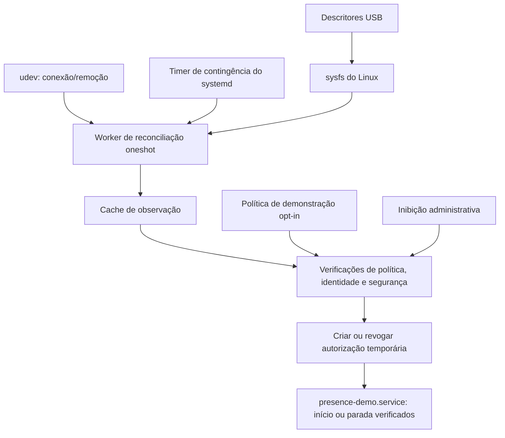

# USB Presence Gate

[](https://github.com/kayo-willian/usb-presence-gate/actions/workflows/test.yml)


[](../LICENSE)


Observador leve de presença USB e mecanismo de controle de serviço com ativação explícita para Linux headless, construído com a biblioteca padrão do Python, sysfs, udev e systemd. Desenvolvi este projeto para explorar a interação entre eventos físicos USB, disponibilidade de serviços e recuperação segura em um notebook Debian com recursos limitados.

A demonstração experimental foi concluída e testada em 22 de novembro de 2026. Revisões posteriores fortaleceram o tratamento de falhas, a sincronização administrativa e a verificação de systemd/udev. O desenvolvimento continua experimental; melhorias adicionais de segurança e validação em ambiente real estão pendentes.

> **Não é um sistema de autenticação nem um produto de segurança para produção.** O mecanismo controla apenas o serviço descartável `presence-demo.service` fornecido pelo projeto. Descritores USB podem ser falsificados. Nunca utilize este projeto para proteger SSH, rede, autenticação, firewalls, Docker ou outros serviços essenciais.

[English](../README.md) · [Instalação](#instalação) · [Uso](#uso) · [Recuperação](#recuperação-de-emergência-sem-python) · [Contribuição](#contribuição) · [Histórico](CHANGELOG.md)

## Índice

- [Como funciona](#como-funciona)
- [Requisitos](#requisitos)
- [Instalação](#instalação)
- [Uso](#uso)
- [Comandos e diagnóstico](#comandos-e-diagnóstico)
- [Desativação, desinstalação e atualizações](#desativação-desinstalação-e-atualizações)
- [Recuperação de emergência sem Python](#recuperação-de-emergência-sem-python)
- [Limitações e extensão](#limitações-e-extensão)
- [Status do projeto e validação](#status-do-projeto-e-validação)
- [Contribuição](#contribuição)
- [Documentação](#documentação)
- [Créditos e licença](#créditos-e-licença)

## Como funciona

O observador lê descritores USB pelo sysfs do Linux. Deriva uma impressão digital (fingerprint) de 12 caracteres a partir dos identificadores de fabricante e produto e do número de série informados pelo dispositivo, utilizando SHA-256. Não lê o conteúdo, monta, formata, criptografa nem escreve no dispositivo.



| Componente | Finalidade |
| --- | --- |
| Varredura USB | Classifica identidades como `identifier-only`, `weak` ou `ambiguous`. |
| udev | Solicita observação após eventos de conexão ou remoção de dispositivos USB. |
| Timer do systemd | Mecanismo periódico de contingência, nominalmente 60 segundos após o worker ficar inativo; o primeiro disparo após a inicialização está configurado para 30 segundos. |
| Observador | Persiste o estado de presença, aplica uma tolerância de ausência de 10 segundos a partir da detecção e reconcilia a demonstração. |
| Política da demonstração | Uma identidade de armazenamento USB cadastrada explicitamente; o cadastro por si só não arma o mecanismo. |
| Autorização temporária (grant) | Permissão temporária para a condição de inicialização do serviço fornecido. |
| Verificações de segurança | Verificam hashes instalados, identidade efetiva das unidades e relações diretas, habilitação do timer na inicialização e integridade da regra udev. |
| Inibição administrativa | Veto persistente à autorização durante operações administrativas incompletas; bloqueios serializam as alterações. |

A demonstração fornecida é um processo ocioso `sleep infinity` executado sob um usuário dinâmico gerenciado pelo systemd. A instalação não o inicia. A observação e a aplicação da política da demonstração exigem ativações explícitas separadas.

### O pendrive precisa de um arquivo de chave?

Não. Um pendrive vazio é suficiente se informar uma identidade inequívoca baseada em número de série e classe de interface de armazenamento USB `08`. Nenhum arquivo secreto, partição especial ou modificação é necessário. A impressão digital dos descritores é um identificador de correlação, não uma credencial criptográfica.

## Requisitos

| Componente | Requisito |
| --- | --- |
| Host de referência | Debian 13 (Trixie), headless ou desktop |
| Gerenciador de serviços | systemd 257 e udev para operação real |
| Runtime | Python 3.13 do sistema; somente biblioteca padrão |
| Desenvolvimento | Git e Make; testes offline também executados com Python 3.12 |
| Administração real | Privilégios de root por sudo; acesso ao console local e uma segunda sessão SSH em caso de acesso remoto |
| Demonstração real | Dispositivo de armazenamento USB comum, não crítico, com número de série utilizável |
| Não necessário | GUI, Docker, VM, pacotes pip, banco de dados ou acesso ao sistema de arquivos USB |

Outras distribuições e arquiteturas não fazem parte do registro de validação em hardware. O desenvolvimento offline não exige pendrive, root ou systemd em execução.

## Instalação

Use um host descartável para testes, não um host de serviços de produção. Leia o [guia de recuperação](docs/recuperacao.md) antes de ativar qualquer componente. As instruções abaixo instalam o código atual de `main`, não uma versão empacotada.

### 1. Instalar pré-requisitos e baixar

```sh
sudo apt update
sudo apt install -y python3 git make
git clone https://github.com/kayo-willian/usb-presence-gate.git
cd usb-presence-gate
git switch main
```

### 2. Verificar o clone

Execute sem sudo:

```sh
make test
python3 -m compileall -q src bin tests
./bin/usbgate --help
```

A suíte tinha 116 testes aprovados após o PR #9. O número pode aumentar conforme o desenvolvimento avança. Em um host systemd adequado, verifique opcionalmente as unidades fornecidas:

```sh
systemd-analyze verify packaging/systemd/presence-demo.service packaging/systemd/usbgate-reconcile.service packaging/systemd/usbgate-reconcile.timer
```

A verificação estática não é um teste de integração real. Em ambientes sem executáveis instalados ou sem um diretório de runtime do gerenciador gravável, pode ser necessário preparar uma raiz de teste; consulte o [workflow de CI](../.github/workflows/test.yml).

### 3. Instalar os arquivos sem ativação

Verifique primeiro os caminhos de instalação existentes. O mecanismo espera arquivos e diretórios pais confiáveis, de propriedade de root, sem permissão de escrita para grupo ou outros usuários. Em particular, examine um `/usr/local` gravável pelo grupo no Debian, em vez de enfraquecer verificações ou alterar permissões recursivamente.

```sh
namei -l /usr/local /etc/systemd/system /etc/udev/rules.d /var/lib
sudo make install
sudo systemctl daemon-reload
sudo /usr/local/sbin/usbgate doctor
sudo /usr/local/sbin/usbgate demo status
sudo /usr/local/sbin/usbgate inspect-unit presence-demo.service
```

O instalador deve informar `Installed inert files; observation is not enabled.`. Uma instalação nova deve apresentar demonstração não configurada, inativa e sem autorização temporária. O timer ainda não está habilitado, portanto não se espera que `monitor_safety` informe `verified` nessa etapa.

Se a instalação recusar um caminho ocupado, link simbólico ou manifesto existente, pare e investigue o motivo. Não sobrescreva a instalação nem exclua seu manifesto. Se a verificação preliminar da unidade recusar a demonstração instalada, resolva o problema informado antes da ativação.

### Caminhos instalados

| Caminho | Finalidade |
| --- | --- |
| `/usr/local/sbin/usbgate` | Inicializador da CLI que utiliza o interpretador Python isolado do sistema |
| `/usr/local/lib/usbgate/` | Módulos Python e regra udev de referência |
| `/etc/systemd/system/presence-demo.service` | Demonstração descartável |
| `/etc/systemd/system/usbgate-reconcile.service` | Worker de observação do tipo oneshot |
| `/etc/systemd/system/usbgate-reconcile.timer` | Timer periódico de observação |
| `/etc/udev/rules.d/70-usbgate.rules` | Implantada somente quando o monitoramento é habilitado |
| `/etc/usbgate/demo.json` | Cadastro e política armada |
| `/run/usbgate/` | Cache volátil de observação, autorização temporária e bloqueios |
| `/var/lib/usbgate/install-manifest.json` | Hashes dos arquivos instalados |
| `/var/lib/usbgate/authorization-inhibited` | Inibição administrativa persistente, quando presente |

## Uso

Este é o fluxo previsto para a implementação atual. As observações anteriores em hardware abrangem o ciclo de vida original da demonstração, não todas as melhorias atuais de segurança.

### 1. Identificar o dispositivo USB

Conecte somente o pendrive de teste que pretende utilizar.

```sh
/usr/local/sbin/usbgate scan
```

Selecione a entrada cujo campo `classes` inclua `08` e cujo campo `assurance` seja `identifier-only`. A chave do objeto JSON é a impressão digital hexadecimal de 12 caracteres minúsculos. Uma identidade `weak` ou `ambiguous` não pode ser cadastrada. Não compartilhe publicamente impressões digitais reais nem números de série brutos.

### 2. Habilitar o monitoramento

```sh
sudo /usr/local/sbin/usbgate monitor enable
sudo /usr/local/sbin/usbgate status --json
systemctl is-enabled usbgate-reconcile.timer
systemctl is-active usbgate-reconcile.timer
```

Resultado esperado: `Observation enabled.`, `monitor_safety: verified`, timer habilitado e ativo e demonstração inativa se nenhuma política estiver armada. O worker oneshot pode permanecer inativo entre varreduras. O monitoramento não cadastra nem arma a demonstração.

### 3. Cadastrar o pendrive selecionado

Informe a impressão digital real exibida na varredura:

```sh
printf "USB fingerprint: "
read -r FINGERPRINT
sudo /usr/local/sbin/usbgate demo enroll "$FINGERPRINT"
sudo /usr/local/sbin/usbgate demo status
```

Resultado esperado: `state: enrolled`, sem autorização temporária e demonstração inativa. O cadastro continua desarmado.

### 4. Habilitar a demonstração descartável

Mantenha o pendrive cadastrado conectado.

```sh
sudo /usr/local/sbin/usbgate demo enable
sudo /usr/local/sbin/usbgate demo status
systemctl is-active presence-demo.service
```

Resultado esperado: política `enabled`, `authorization_inhibited: false`, `grant_file: true`, `service_state: active` e `service_active: true`.

Uma política marcada como `enabled` está apenas armada; isso não comprova a presença do dispositivo nem a execução do serviço. Uma parada manual do serviço pode ser revertida durante a reconciliação se o USB cadastrado continuar elegível. Utilize `demo disable` para uma parada duradoura.

### 5. Testar remoção e reconexão (opcional)

No host descartável de teste, desconecte apenas o pendrive cadastrado. Nunca desconecte um adaptador de rede USB ou o armazenamento do host. Após a detecção e o período de tolerância, consulte:

```sh
sudo /usr/local/sbin/usbgate demo status
sudo /usr/local/sbin/usbgate status --json
systemctl is-active presence-demo.service
sudo journalctl -t usbgate -n 40 --no-pager
```

Resultado esperado após reconciliação bem-sucedida: ausência da autorização temporária, demonstração inativa e dispositivo selecionado marcado como ausente. Reconecte o mesmo pendrive e repita as verificações; um dispositivo elegível pode restaurar a autorização e o serviço.

O período de tolerância começa **após a detecção da ausência**, não no momento da desconexão física. Um evento perdido pode adiar a detecção até uma varredura do timer; falhas de agendamento ou do gerenciador podem acrescentar um atraso sem limite definido.

### 6. Verificar recuperação após inicialização (opcional)

Somente em uma máquina de teste com acesso físico para recuperação, reinicie com a demonstração armada e o pendrive selecionado conectado:

```sh
sudo reboot
```

Após restabelecer o acesso e permitir a execução do timer de inicialização, verifique:

```sh
sudo /usr/local/sbin/usbgate demo status
sudo /usr/local/sbin/usbgate status --json
systemctl is-enabled usbgate-reconcile.timer
systemctl is-active presence-demo.service
```

A inicialização com o pendrive conectado foi observada na revisão original testada no notebook. O comportamento após reinicialização com as verificações atuais de segurança ainda precisa de validação real.

## Comandos e diagnóstico

| Comando | Função |
| --- | --- |
| `usbgate scan` | Ler descritores USB atuais |
| `sudo usbgate doctor` | Inspecionar pré-requisitos e segurança do monitor |
| `sudo usbgate status --json` | Exibir cache de observação e estado do monitor/demonstração |
| `usbgate inspect-unit presence-demo.service` | Verificação preliminar da unidade, somente leitura; nunca cadastra |
| `sudo usbgate monitor enable` | Habilitar explicitamente a observação |
| `sudo usbgate monitor disable` | Desabilitar a observação e verificar a desativação persistente |
| `sudo usbgate demo enroll FINGERPRINT` | Armazenar uma identidade elegível, desarmada |
| `sudo usbgate demo enable` | Armar explicitamente a demonstração |
| `sudo usbgate demo disable` | Desarmar e tentar um encerramento verificado |
| `sudo usbgate demo reset` | Remover um cadastro desabilitado após o encerramento |
| `sudo usbgate demo status` | Exibir política, inibição, autorização e estado real do serviço |

Utilize `/usr/local/sbin/usbgate` no lugar de `usbgate` se o inicializador não estiver no PATH. O subcomando interno `reconcile --observe` destina-se ao worker, não à administração normal.

### Interpretar o status

| Campo | Interpretação |
| --- | --- |
| `state` | Estado do cadastro/política: não configurado (`unconfigured`), cadastrado (`enrolled`), habilitado (`enabled`) ou corrompido (`corrupt`) |
| `authorization_inhibited` | Veto persistente a novas autorizações |
| `grant_file` | Indica se o arquivo de autorização está presente |
| `service_state` | Estado confirmado: ativo, inativo, em transição, com falha ou desconhecido |
| `service_active` | Booleano de compatibilidade; nulo em transição, falha ou estado desconhecido |
| `timer_active` | Apenas atividade atual do timer; nulo se não confirmada |
| `monitor_safety` | Configuração do monitor verificada no momento da inspeção ou um diagnóstico |
| `enforcement` | Política armada sem o marcador de inibição; não comprova aplicação real da política |

### Solução de problemas

Comece com diagnósticos somente de leitura:

```sh
sudo /usr/local/sbin/usbgate doctor
sudo /usr/local/sbin/usbgate status --json
sudo systemctl status usbgate-reconcile.timer usbgate-reconcile.service presence-demo.service --no-pager
sudo journalctl -u usbgate-reconcile.service -n 60 --no-pager
sudo journalctl -t usbgate -n 60 --no-pager
```

| Sintoma | Próximo passo seguro |
| --- | --- |
| Nenhum USB elegível | Confira a varredura de descritores; não contorne as verificações de número de série ou ambiguidade. |
| Monitor indisponível | Inspecione `monitor_safety`, habilitação do timer, manifesto instalado e regra; resolva o problema informado. |
| Diretório não confiável ou arquivo modificado | Revise propriedade, permissões e hashes; não sobrescreva arquivos nem enfraqueça verificações. |
| Autorização inibida | Siga a [recuperação de operações administrativas interrompidas](docs/recuperacao.md#operações-administrativas-interrompidas). |
| Demonstração ativa após remoção | Verifique os tempos de observação e diagnósticos de parada; utilize a recuperação se não for possível confirmar o encerramento. |
| Unidade insegura para parar | Inspecione a unidade efetiva e suas relações antes de qualquer ação manual. |
| Estado desconhecido do gerenciador | Trate como não confirmado; não presuma que o serviço parou. |
| Recusa de instalação/desinstalação | Preserve o manifesto e investigue o caminho ou estado indicado. |

Remova identificadores privados e credenciais dos logs que compartilhar. Relate problemas comuns pelas [issues](https://github.com/kayo-willian/usb-presence-gate/issues); suspeitas de vulnerabilidades devem seguir [SEGURANCA.md](SEGURANCA.md).

## Desativação, desinstalação e atualizações

### Desativação normal

Se houver um cadastro, desarme-o e remova a política:

```sh
sudo /usr/local/sbin/usbgate demo disable
sudo /usr/local/sbin/usbgate demo reset
```

Pule esses dois comandos se a demonstração nunca foi cadastrada. Não prossiga após uma desativação ou redefinição malsucedida até resolver o diagnóstico correspondente.

Desabilite o monitoramento:

```sh
sudo /usr/local/sbin/usbgate monitor disable
sudo /usr/local/sbin/usbgate demo status
systemctl is-enabled usbgate-reconcile.timer
systemctl is-active usbgate-reconcile.timer
systemctl is-active usbgate-reconcile.service
systemctl is-active presence-demo.service
```

Resultado esperado: timer desabilitado, as três unidades inativas e demonstração não configurada, sem autorização temporária. Códigos de saída diferentes de zero de `is-active` ou `is-enabled` podem ser normais para unidades inativas ou desabilitadas. Uma desativação bem-sucedida do monitor também verifica a ausência do link persistente do timer antes de liberar a inibição administrativa.

### Desinstalação

A partir do **mesmo clone e revisão do código utilizados na instalação**:

```sh
sudo make uninstall
sudo systemctl daemon-reload
test ! -e /usr/local/sbin/usbgate && echo "USB Presence Gate removed"
```

O instalador recusa a remoção se restar uma política, autorização temporária, regra implantada ou inatividade não confirmada de uma unidade, ou se um arquivo pertencente ao manifesto estiver modificado ou ausente. Não contorne essas recusas.

### Atualizar uma instalação existente

Não há comando de atualização no local. Primeiro desarme, redefina, desabilite o monitoramento e desinstale utilizando o clone da revisão instalada. Somente após a remoção bem-sucedida, atualize o clone e reinstale:

```sh
git switch main
git pull --ff-only origin main
make test
sudo make install
sudo systemctl daemon-reload
```

Repita o procedimento explícito de monitoramento e cadastro, se desejar. Consulte o [histórico](CHANGELOG.md) antes de atualizar.

### Dados residuais

A desinstalação não remove backups da política, logs, arquivos voláteis de observação, bloqueios residuais, o marcador persistente de inibição nem o clone do código. Inspecione os diretórios restantes do projeto antes de remover arquivos individuais. Preserve um marcador de inibição até que uma recuperação bem-sucedida do monitor o limpe. Nunca remova diretórios compartilhados do sistema nem sobrescreva backups existentes.

## Recuperação de emergência sem Python

A recuperação não deve exigir o pendrive cadastrado nem um interpretador Python funcional. O procedimento abaixo se aplica somente às unidades originais pertencentes ao projeto. Leia primeiro o [guia detalhado de recuperação](docs/recuperacao.md).

**Se alguma unidade ou regra tiver sido modificada, inspecione e resolva essa divergência antes de agir.** Parar uma unidade modificada pode afetar serviços não relacionados. Preserve evidências e não exclua uma regra modificada pelo administrador.

Para unidades originais verificadas e uma regra implantada inalterada pertencente ao projeto, desabilite o timer, remova a regra implantada se presente, recarregue o udev e pare o worker:

```sh
sudo systemctl disable --now usbgate-reconcile.timer
sudo rm -f /etc/udev/rules.d/70-usbgate.rules
sudo udevadm control --reload
sudo systemctl stop usbgate-reconcile.service
```

Após confirmar que o worker está inativo, revogue a autorização temporária e pare a demonstração verificada:

```sh
sudo rm -f /run/usbgate/demo-grant
sudo systemctl stop presence-demo.service
```

Se existir uma política ativa, mova-a para outro nome sem sobrescrever um backup:

```sh
sudo mv -n /etc/usbgate/demo.json /etc/usbgate/demo.json.disabled
sudo systemctl daemon-reload
```

Se o backup já existir, escolha um nome exclusivo. Preserve a inibição persistente de autorização, se presente. Verifique o resultado:

```sh
systemctl is-enabled usbgate-reconcile.timer
systemctl is-active usbgate-reconcile.timer
systemctl is-active usbgate-reconcile.service
systemctl is-active presence-demo.service
sudo test ! -e /run/usbgate/demo-grant && echo "Grant absent"
sudo test ! -e /etc/usbgate/demo.json && echo "Live policy absent"
```

O timer deve estar desabilitado, as três unidades inativas e ambas as verificações de ausência bem-sucedidas. Um comando malsucedido ou incerto não comprova a recuperação; pare e investigue, utilizando o console local se necessário. O procedimento de recuperação original foi exercitado em hardware; esta ordem revisada e as melhorias atuais de segurança ainda precisam de validação real. A desinstalação é uma operação separada, após a confirmação do encerramento.

## Limitações e extensão

- É possível falsificar descritores; isto não é autenticação, autorização de dispositivos USB nem criptografia.
- Somente uma identidade de armazenamento USB e uma demonstração descartável fornecida são suportadas.
- Não há cadastro genérico de serviços/sockets, aplicação de políticas em produção, mecanismo de múltiplas políticas, integração PAM ou autenticação baseada em hardware.
- A tolerância de dez segundos a partir da detecção não garante o tempo entre desconectar e parar o serviço.
- `ConditionPathExists` é verificada na inicialização; remover a autorização por si só não encerra um serviço em execução.
- A verificação do systemd examina arquivos instalados e um retrato das relações diretas. Não pode comprovar todos os efeitos transitivos, excluir alterações privilegiadas posteriores nem garantir a entrega de eventos.
- Se não for possível estabelecer uma desativação segura, o sistema informa a falha em vez de emitir uma parada sem verificação. A recuperação manual pode ser necessária.

Um fork separado pode adaptar o código da demonstração fornecida para outra carga de teste independente, não crítica e executada em primeiro plano, após revisão e nova validação. Isso substitui a única carga de trabalho; não cadastra um serviço existente. Consulte o [guia de extensão](docs/extensao.md). Alterações para controlar serviços arbitrários ou realizar autenticação exigem um projeto separado e não devem ser consideradas suportadas.

## Status do projeto e validação

| Marco | Evidência |
| --- | --- |
| Demonstração experimental original | Testes em notebook físico com Debian 13 em 2026-11-22 |
| [Reconciliação segura em caso de falha](https://github.com/kayo-willian/usb-presence-gate/pull/7) | 63 testes de regressão offline |
| [Consistência administrativa](https://github.com/kayo-willian/usb-presence-gate/pull/8) | 89 testes de regressão offline, incluindo testes reais de concorrência com flock |
| [Verificação de systemd e udev](https://github.com/kayo-willian/usb-presence-gate/pull/9) | 116 testes de regressão offline e validação estática do systemd na CI |
| Fortalecimento da observação USB e do runtime | Planejado; ainda não implementado como marco separado de segurança |
| Recuperação, instalação e validação final | Planejado; verificações físicas da revisão atual continuam pendentes |

Os testes históricos no notebook abrangeram o ciclo de vida original da demonstração, remoção e reconexão físicas, recusa de inicialização manual, inicialização com pendrive conectado, recuperação de emergência e desinstalação após recuperação. Eles não validam todas as alterações mais recentes.

O código atual informa a versão `0.1.0`. Consulte [CHANGELOG.md](CHANGELOG.md) para o histórico de desenvolvimento; datas de marcos não representam releases com tags. Não há compromisso de cronograma de manutenção ou lançamento.

## Contribuição

Contribuições são bem-vindas, tanto de quem está aprendendo Linux quanto de quem já trabalha com systemd, enumeração USB, Python ou infraestrutura. Você pode relatar um problema reproduzível, melhorar a documentação, adicionar testes de regressão, revisar um limite de segurança ou propor uma melhoria.

O processo de revisão do projeto original é deliberadamente conservador porque o projeto opera com privilégios elevados. Forks independentes permanecem livres para evoluir sob a licença MIT.

### Começar a contribuir

1. [Faça um fork do repositório](https://github.com/kayo-willian/usb-presence-gate/fork).
2. Clone seu fork e crie uma branch específica a partir da `main` do projeto original.
3. Leia [CONTRIBUICAO.md](CONTRIBUICAO.md) e [AGENTS.md](../AGENTS.md).
4. Execute `make test`, faça sua alteração, adicione testes de regressão relevantes e repita a validação.
5. Abra um pull request para `main` utilizando o modelo de PR do repositório.

Nenhum dispositivo USB físico ou instalação privilegiada é necessário para desenvolvimento comum e testes offline. Mantenha as alterações focadas. O README, o guia de contribuição, o código de conduta e a política de segurança estão disponíveis em inglês e português brasileiro. A documentação técnica também está disponível nos dois idiomas, com a versão em inglês como referência; os commits e PRs permanecem em inglês. Discuta mudanças de arquitetura e novas dependências antes da implementação. Declare assistência relevante de IA e relate os resultados dos testes com transparência.

| Recurso da comunidade | Finalidade |
| --- | --- |
| [Guia de contribuição](CONTRIBUICAO.md) | Requisitos de desenvolvimento, segurança, testes e revisão |
| [Código de conduta](CODIGO_DE_CONDUTA.md) | Expectativas de participação respeitosa |
| [Política de segurança](SEGURANCA.md) | Divulgação responsável e opções de comunicação privada |
| [Relatar um bug ou propor uma melhoria](https://github.com/kayo-willian/usb-presence-gate/issues/new/choose) | Modelos de issues |
| [Pull requests](https://github.com/kayo-willian/usb-presence-gate/pulls) | Alterações propostas e revisões |
| [Histórico](CHANGELOG.md) | Alterações significativas integradas e histórico de validação |

## Documentação

| Documento | Descrição |
| --- | --- |
| [Segurança da demonstração](docs/seguranca-da-demonstracao.md) | Verificação efetiva das unidades, transições administrativas e evidências em hardware |
| [Validação em hardware](docs/validacao-em-hardware-2026-11-22.md) | Testes originais do observador |
| [Recuperação](docs/recuperacao.md) | Diagnóstico, recuperação de interrupções e remoção |
| [Guia de extensão](docs/extensao.md) | Experimentação segura no código dentro dos limites da demonstração |
| [Modelo de ameaças](docs/modelo-de-ameacas.md) | Riscos, premissas e exclusões |
| [Conclusão e escopo futuro](docs/plano-de-conclusao.md) | Marco original e possíveis extensões |
| [Revisão histórica do design](docs/revisao-fase-0.md) | Propostas anteriores, não instruções operacionais atuais |
| [Trabalhos anteriores](docs/trabalhos-anteriores.md) | Inspiração e implementação independente |
| [Hipóteses](docs/hipoteses.md) | Verificações e evidências do notebook |
| [Ciclo de vida histórico](docs/ciclo-de-vida.md) | Proposta anterior, não implementada integralmente |
| [Procedimentos experimentais](docs/procedimentos-experimentais.md) | Planos históricos de testes, não instruções atuais |

## Créditos e licença

A ideia, os requisitos e o trabalho em laboratório físico partiram do mantenedor. Ferramentas de IA contribuíram para revisão da arquitetura, código, testes e documentação; o mantenedor revisa as alterações e fornece evidências de validação física.

Inspirado em **Henrique ([@rique-decoder](https://github.com/rique-decoder))** e seu projeto educacional [Linux USB Security Token](https://github.com/rique-decoder/linux-usb-security-token). Esta é uma implementação independente e não inclui código-fonte do projeto original. [USBGuard](https://github.com/USBGuard/usbguard) é um projeto separado para autorização de dispositivos USB.

Distribuído sob a [licença MIT](../LICENSE).
